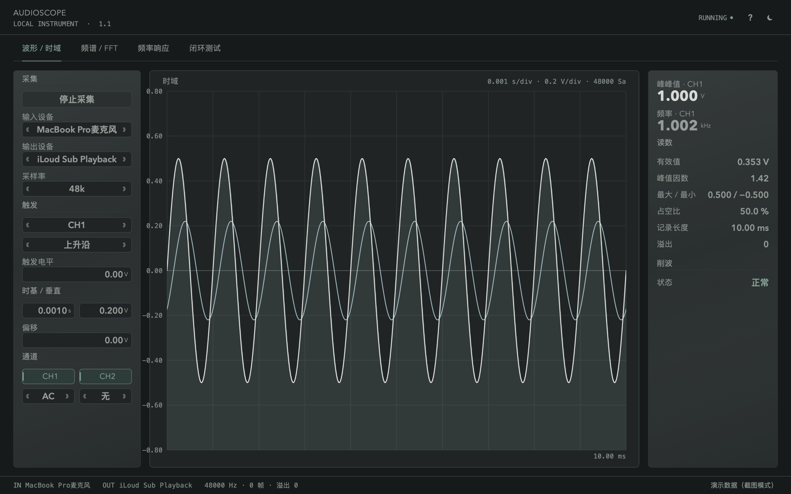
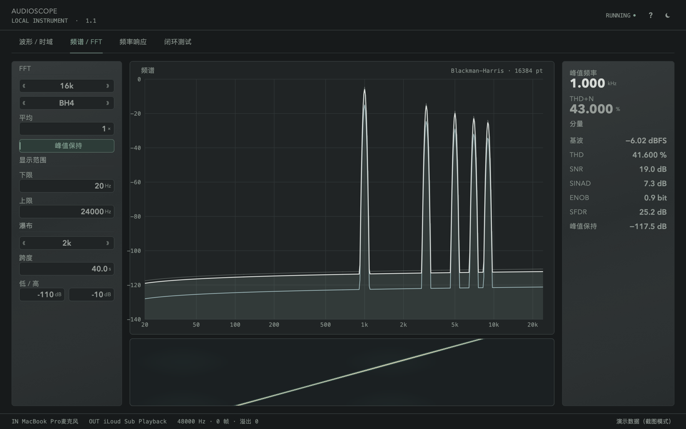
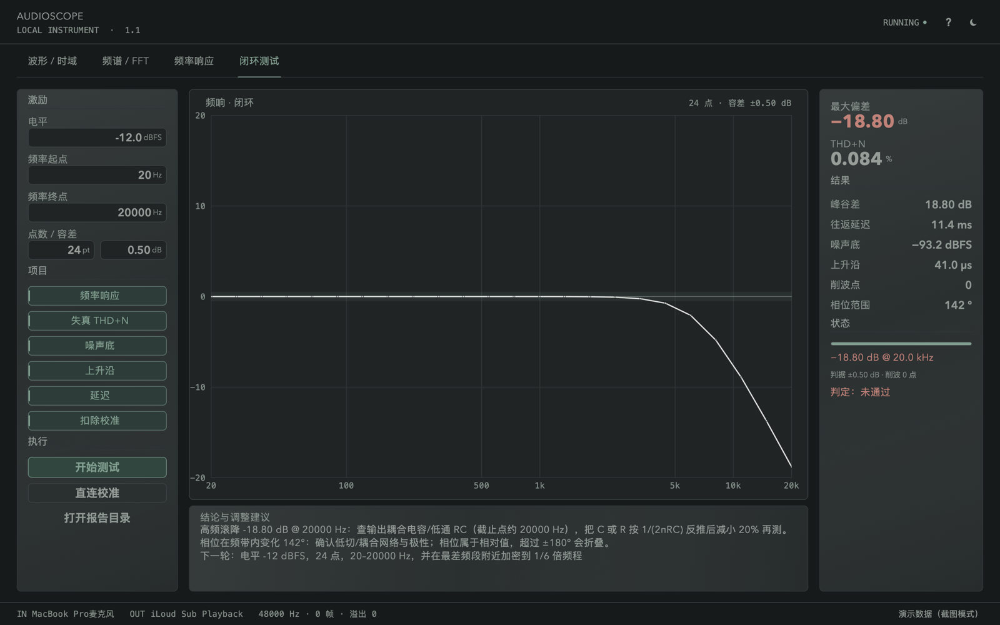
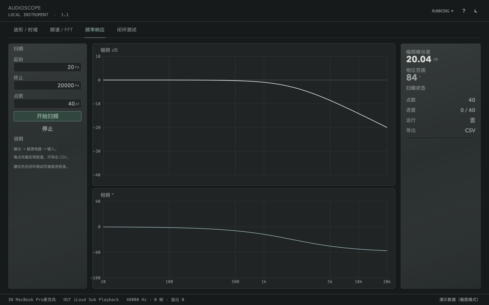
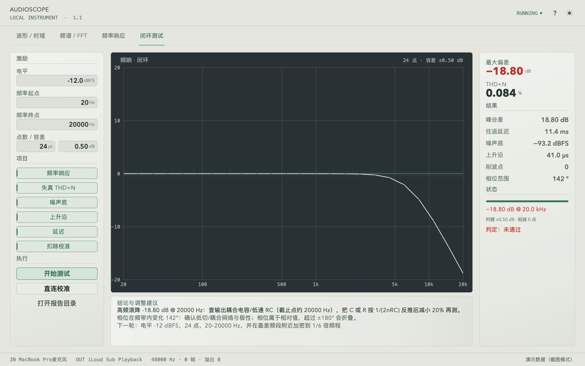
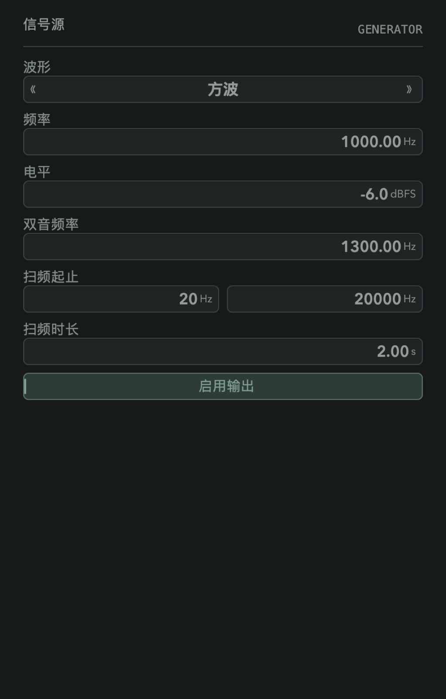

# AudioScope by BerryStudio

**声卡音频维修工作台 · Sound-card audio repair workstation**

[](LICENSE)
[](alpha/README.md)
[](alpha/README.md)

> **0.9.2-beta（Native）**：见 [`alpha/README.md`](alpha/README.md)。
> 路线图：[`docs/plan/ROADMAP.md`](docs/plan/ROADMAP.md) · [`docs/plan/V0.9.2.md`](docs/plan/V0.9.2.md)。
> 原 v1.1 保留在 tag `v1.1.0-initial`；0.1–0.6-alpha 保留在各自 tag。
>
> **English** — AudioScope by BerryStudio is a sound-card audio repair workstation:
> a protected, calibrated, guided measurement flow for macOS and Windows.
> 0.9.2-beta finishes the Windows parity pass started in 0.9.1: true minus signs,
> axis ticks on scope and spectrum, a report empty state, a persistent safety
> note, proportional table columns and unified header/footer typography.
> 0.9.1 fixed the interaction layer (time-based tab animation, proportional
> window scaling, 60 Hz, cached rendering, dark chart surface in the light
> theme). v1.1 is preserved at tag `v1.1.0-initial`.

---

## 0.9.2-beta at a glance

| | |
|---|---|
| 定位 | 声卡音频维修工作台，不是通用示波器 |
| 平台 | macOS 12+ arm64 · Windows 10/11 x64 |
| 语言 | C11 实时核心 + C++17 应用/平台层 |
| 当前版本 | `0.9.2-beta.1`（Native） |
| 这一版 | Windows 补齐真减号、轴刻度、空状态、安全声明、表格列宽与页眉页脚排印 |
| 现在能做 | 原生 macOS `.app` / Windows 安装包、七页界面、多页 PDF、loopback、维修计划、THD/IMD、wow/flutter、串扰、阻抗、方位角、多通道、XY、热力图、校准 |
| 还没做 | WASAPI、设备选择、校准向导、游标/缩放、签名/公证、Windows 真机音频验证 |
| 安全 | 软件不能保护声卡；高压/未知信号必须经过受保护前端 |

构建与运行：

```bash
cd alpha
make app          # macOS: build/AudioScope.app
make mac          # CLI
make test         # selftest + nav 动画回归 + native --shot
make win          # Windows CLI cross-build (mingw-w64)
# Windows native exe + installer are built by CI (MSVC + Inno Setup).
```

---

## v1.1 原实现（历史）

macOS 原生的**声卡示波器 / 频谱仪 / 闭环测试仪**：纯 C + 系统框架实现，
1 个 170 KB 二进制、零第三方依赖、启动 < 0.1 s。v1.1 源码保留在 tag
`v1.1.0-initial`（以及 `v1.1` 标签）；`main` 分支现在跟随 0.9.x 原生版。



它由 Python + PyQt6 原型重写而来，1.1 在 1.0 基础上做了两件事：

1. **界面整体重绘**：按“精密仪器”视觉规范重做（暖灰石墨面板、单一鼠尾草绿重点色、
   三种排印角色、4px 网格、图表 32px 安全区、仅向下填充、去掉一切发光/霓虹/JUCE 味）。
2. **新增本地闭环测试**：自写波形算法 + 自动校准 + 采集分析 + 报告导出，
   输出可比较、可复现的 JSON/CSV/WAV，并给出电路调整建议与下一轮测试参数。

| | 原 Python 原型 | 本项目（C） |
|---|---|---|
| 运行时依赖 | Python 3.9 + venv（273 MB） | 无（只用系统框架） |
| 可执行文件 | venv + 20+ 个包 | **1 个 170 KB 二进制**，`.app` 约 180 KB |
| 启动 | 1–2 s（导入 numpy/PyQt） | **< 0.1 s** |
| 界面 | PyQt6 + pyqtgraph | 自绘 CoreGraphics + CoreText（自带主题令牌） |
| 音频 | sounddevice / PortAudio | CoreAudio HAL（IOProc 直连） |
| FFT | numpy（Accelerate） | 自己的 radix-2 FFT |
| 文件解码 | soundfile + afconvert | CoreAudio ExtAudioFile（WAV/MP3/FLAC/M4A/AAC/ALAC…） |

---

## 1. 编译与运行

不想自己编译：从 [Releases](https://github.com/mmr0817/audioscope/releases/latest)
下载 `AudioScope-1.1-macos-arm64.dmg`，拖进 Applications 即可。

```bash
make            # 生成 build/AudioScope
make app        # 打包成 build/AudioScope.app
make dmg        # 打包成 build/AudioScope-1.1.dmg
make release    # dist/：带架构名的 DMG + ZIP + SHA256SUMS（发布用）
make run        # 直接启动
make test       # DSP 自检（30 项）+ 单元测试（23 项）
make shot       # 离屏渲染 6 张界面图到 build/shots
make win-core   # （可选）用 mingw-w64 交叉编译纯 C 核心为 Windows PE
```

运行要求：Apple Silicon（arm64），macOS 12.0 或更新（二进制 `minos=12.0`）。
0.9 起 Windows 有独立的 Win32 + GDI+ 图形版和安装包；音频仍是 WinMM 2ch，
WASAPI 尚未实现。`win/core_main.c` 仍保留为纯 C 测量内核的交叉编译脚手架。

只依赖 Xcode Command Line Tools（clang + macOS SDK），**没有任何第三方库**。
链接的系统框架：Cocoa、CoreAudio、AudioToolbox、AudioUnit、CoreGraphics、CoreText、ImageIO。

首次运行会请求**麦克风权限**，必须允许，否则没有输入信号。

---

## 2. 界面（1.1 设计语言）

| 频谱 / FFT + 瀑布 | 闭环测试（幅频 / 相频） |
|---|---|
|  |  |
| **幅频 / 相频（Bode）** | **明色主题** |
|  |  |

规范落地的几条硬规则（都能在代码里找到对应实现）：

| 规则 | 实现位置 |
|---|---|
| 语义颜色令牌，只有一处定义；暗色为主，明色不是反相 | `src/theme.h` / `src/theme.c` |
| 单一重点色（鼠尾草绿）只用于当前/选中/正常；琥珀=注意、砖红=超限 | `Palette` 里的 `accent / warn / bad` |
| 三种排印角色：Label 14（uppercase + tracking）/ Value 16（等宽数字）/ Critical 26 | `ui.c` 的 `FONT_LABEL / FONT_VALUE / FONT_CRIT`（`tnum` 特性，刷新不抖动） |
| 每屏最多两个“关键大数字”，其余行式读数 | `big_number()` / `kv()` |
| 网格 4px；组内 8、区块 16、大分组 24、图表安全区 32 | `theme.h` 的 `GAP1..GAP8` |
| 材质只有两种：raised（左上提亮/右下压暗 + 接触阴影）、recessed（顶部内阴影） | `mat_raised()` / `mat_recessed()` |
| 图表：主曲线最亮且最粗，填充只向下，网格低对比 | `polyline()` / `fill_down()` |
| 状态：hover / pressed / selected / focus / disabled / warning 都要能区分 | `ui_button/ui_toggle/ui_cycle/ui_field` |
| 无持续装饰动画；过渡 140ms，系统“减少动态”时立即 | `g_reduce_motion`（读系统设置） |
| 数字用真减号 −，缺失用 —，范围用 – | `pretty_minus()` |
| 瀑布不用彩虹色 | `as_cmap()`：鼠尾草/石墨/冷灰/靛青，单调亮度 |

页眉右侧是低频操作（帮助、主题切换）；页脚是技术状态行（设备、采样率、缓冲、溢出、消息）。

---

## 3. 功能

**主窗口四个页签**

- **波形 / 时域**：触发源/边沿/电平、时基、垂直、AC/DC、A+B/A−B；右侧 Vpp、频率两个大数字 + 行式读数
- **频谱 / FFT**：1k–128k 点、6 种窗、平均、峰值保持、对数频率范围；下方瀑布图（时间×频率）
- **频率响应**：起止频率/点数扫频，幅频 + 相频上下两图，可导出 CSV
- **闭环测试**（1.1 新增，见第 4 节）

**信号源窗口**：正弦/方波/三角/锯齿/白噪/粉噪/双音/扫频，电平 −80…0 dBFS，
播放任意系统支持的音频文件（CoreAudio 解码 + 自动重采样）。

**AUTO**（F6）：自动选通道、测频率、定时基与垂直档位并居中。

---

## 4. 闭环测试（1.1 新增）

链路：**声卡输出 → 被测电路 → 声卡输入**，全程本地，不联网、不上传。

### 4.1 模块

```
src/wavegen.c/h   测试信号发生器：相位累加器 + PolyBLEP 带限 + 固定种子噪声
src/calib.c/h     校准数据：逐频点幅相 + 延迟，JSON 读写，对数轴插值
src/analyze.c/h   采集分析：互相关对齐（亚采样）、单频点幅相、同步平均、噪声底、上升沿
src/report.c/h    报告：JSON / CSV / 24-bit WAV + 规则式建议
src/loopback.c/h  流程状态机：延迟 → 频响 → THD+N → 噪声 → 上升沿 → 报告
tests/unit.c      23 项单元测试 + 虚拟 DUT 端到端验证
scripts/run_loopback.sh  可重复测试脚本（不需要硬件）
```

### 4.2 波形精度（可量化）

| 波形 | 频率误差 | 幅度误差 | 非谐波杂散 |
|---|---|---|---|
| 正弦 | 0 ppm（20 Hz–15 kHz） | 0.000 dB | −122 dBc |
| 三角 | — | 0.000 dB | −43 dBc |
| 方波（PolyBLEP） | 0 dB 峰值 | 0.000 dB | −25 dBc（奈奎斯特附近谐波折叠） |
| 白噪/粉噪 | 固定种子，同参数逐位一致 | — | — |

这些数字是 `--unittest` 每次实测算出来的，不是写在文档里的话。

### 4.3 流程

1. **直连校准**：输出直接回接输入，扫描 20 Hz–20 kHz，记录声卡本身的幅相误差与往返延迟，
   存 `~/Documents/AudioScope/calibration.json`；
2. **接入被测电路**，勾选“扣除校准”，点“开始测试”；
3. 每点先稳定（≥40 个周期）再采 8192 点，用互相关对齐后做单频点 DFT，得到增益与相位；
4. 1 kHz 测 THD/THD+N/SNR/SINAD，静音测噪声底，1 kHz 方波测 10–90% 上升沿，扫频测延迟；
5. 输出 `report-YYYYmmdd-HHMMSS.json`、`report-*.csv`、`capture-*.wav` 到 `~/Documents/AudioScope`。

### 4.4 报告与建议

报告里有：频响 24 点（增益/相位）、峰谷差、最大偏差及频点、THD、THD+N、SNR、SINAD、
噪声底、往返延迟、上升沿、削波点数、判定。设置哈希写在 JSON 里，**同一设置重复运行逐字节一致**
（`scripts/run_loopback.sh` 会真的比对两次输出）。

建议是规则推理，不是“AI 生成”：

- 高频滚降 → 指出截止频点并给出 `f = 1/(2πRC)` 的调整方向；
- 低频衰减 → 耦合电容/变压器的量化建议；
- THD+N 偏高 → 先降 6 dB 电平复测以区分失真与噪声；
- 削波 → 自动给出下一轮电平；
- 每份报告最后一行是**下一轮参数**（电平、点数、频段加密方式）。

---

## 5. 快捷键

| 键 | 作用 |
|---|---|
| ⌘R | 开始 / 停止采集 |
| ⌘⇧A 或 F6 | AUTO 自适应 |
| ⌘G | 信号源窗口 |
| ⌘O | 打开音频文件 |
| ⌘S / ⌘⇧S / ⌘B | 保存 WAV / CSV / 频响 CSV |
| ⌘P | 截图 |
| ⌘0 | 复位缩放 |
| T | 切换明/暗主题 |
| 空格 | 冻结 |
| ← / → | 时基缩放 |
| ⌘Q | 退出 |

信号源窗口（⌘G）：内置正弦 / 方波 / 三角 / 扫频发生器，也能直接播放本地音频文件。



---

## 6. 架构

```
src/
├── theme.h/.c        设计令牌（颜色/间距/圆角/排印），暗色与明色两套
├── dsp.h/.c          发生器、触发、时域测量、FFT、THD/SNR/SINAD/ENOB/SFDR、对数分箱、格式化
├── audio.h/.c        CoreAudio 双设备 IOProc、环形缓冲、重采样、ExtAudioFile 解码、帧计数
├── ui.h/.c           立即模式控件 + 材质 + 字体（含 tnum）+ 全部状态
├── view.c            四个页签的图表与面板、页眉/导航/页脚、信号源窗口
├── app.h/.c          状态、设置持久化、30 Hz 主循环、AUTO、扫频、闭环测试调度、导出
├── wavegen/calib/analyze/report/loopback   1.1 新增测量链
├── main.m            AppKit 外壳、菜单、事件、文件对话框、CLI 入口
└── tests/            selftest.c（30 项）、unit.c（23 项 + 虚拟 DUT）
```

音频回调在 CoreAudio 线程；UI 在 30 Hz 定时器里读环形缓冲；生成器配置用互斥锁整体替换
（1.1 修掉了 1.0 里无锁写 `gen_cfg` 的潜在撕裂读）。

---

## 7. 自检与验证

```bash
make test                          # --selftest + --unittest
./build/AudioScope --simulate DIR  # 用已知传递函数的虚拟 DUT 跑完整分析链
./scripts/run_loopback.sh          # 上面全部 + 两遍结果逐字节比对
./build/AudioScope --devices       # 列出 CoreAudio 设备
./build/AudioScope --audiotest     # 真开设备跑 2 s，打印回调/电平/溢出
./build/AudioScope --shot build/shots
```

本机（MacBook Pro，48 kHz，内置麦克风 + 耳机）实测：
`--selftest` 30/30、`--unittest` 23/23、`--audiotest` `in_cb=198 out_cb=204 xrun=0`、
`--simulate` 频响误差 0.000 dB（24 点全频段）。

---

## 8. 常见问题

**没有波形 / 峰值 −180 dBFS**：麦克风权限没给，或输入设备选错、输入增益为 0。

**闭环测试没有读数**：先确认“开始采集”是运行状态；再确认输出确实接到了输入（可先做直连校准，
校准时应看到 0 dB 附近的一条平线）。

**相位看起来在跳**：相位是相对值，超过 ±180° 会折叠；跨频点比较时看趋势，不要看绝对值。

**打包后提示「无法验证开发者」**：`make app` 已做 ad-hoc 签名；右键 → 打开，或
`xattr -dr com.apple.quarantine build/AudioScope.app`。

**读数不准**：在左栏“满量程”里填输入口 0 dBFS 对应的峰值电压（万用表标定）。

---

## 9. 许可证与贡献

本项目以 **Apache License 2.0** 开源：全文见 [LICENSE](LICENSE)，版权与归属声明见 [NOTICE](NOTICE)。

- 可自由商用、修改、再分发（包括闭源产品），需保留版权、许可证与 NOTICE 声明；
- 包含明确的专利授权条款，贡献者的专利授权不会因诉讼而随意撤回；
- 软件按“现状”提供，不含任何明示或暗示的担保。

欢迎提 Issue / PR。提交前请保持本项目的两个硬约束：

1. **零第三方依赖**——只调用 macOS 系统框架（Cocoa / CoreAudio / CoreText 等）；
2. **可复现**——`make test` 全绿，`./scripts/run_loopback.sh` 两遍报告逐字节一致。

提交代码即表示同意以 Apache-2.0 授权你的贡献（无需额外签署 CLA）。


