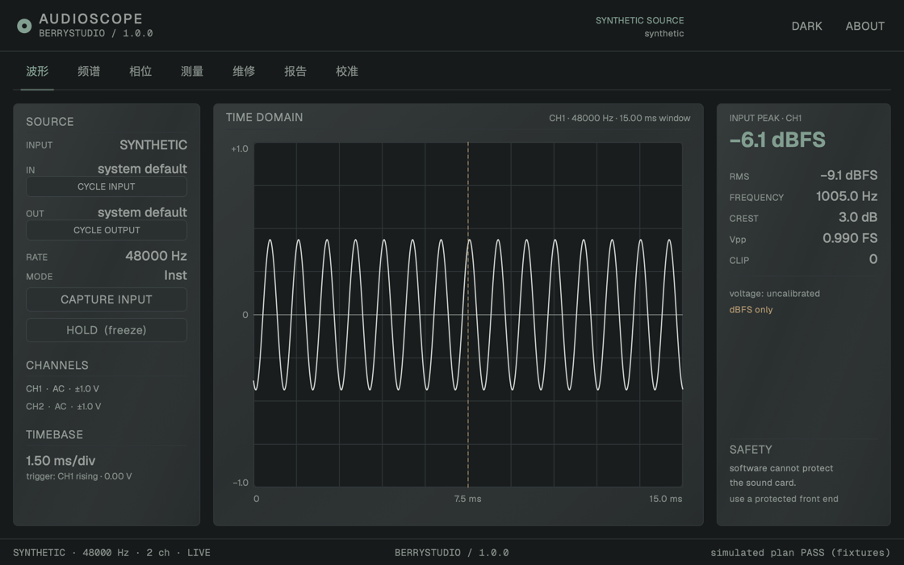
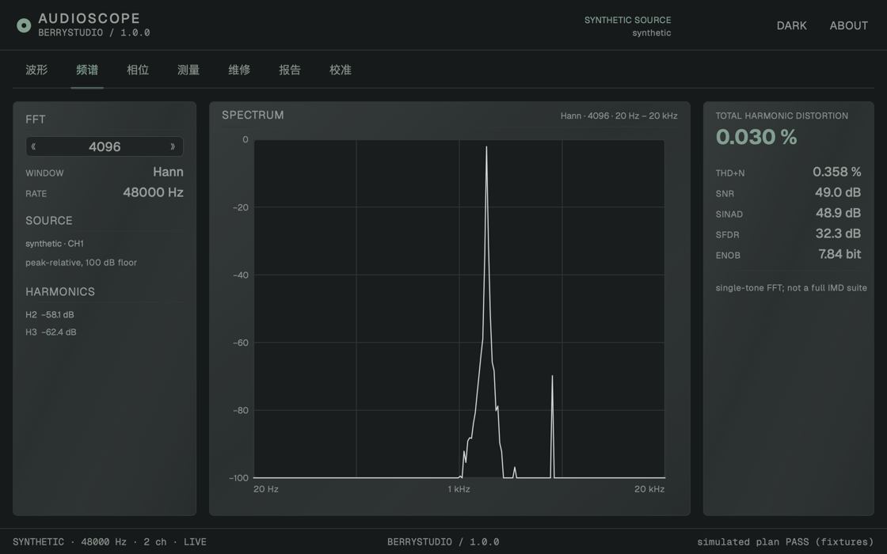
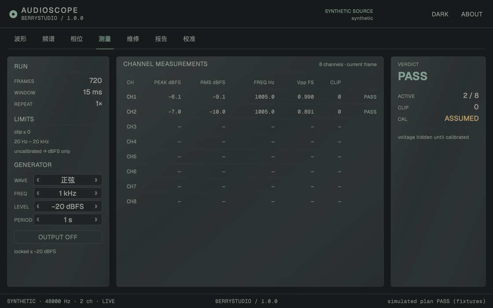

# AudioScope by BerryStudio

**用声卡做音频测量的维修工作台** · Sound-card audio repair workstation

[](https://github.com/BerryStudio-Beijing/audioscope/releases/latest)
[](LICENSE)
[](alpha/README.md)
[](alpha/README.md)

AudioScope 把一块普通声卡变成一台七页测量仪器：波形、频谱、相位/XY、通道测量、
维修流程、报告与校准。界面是 macOS AppKit/CoreGraphics 与 Windows Win32/GDI+
原生绘制，核心是 C11，应用层是 C++17；没有 WebView、没有网络访问、没有遥测，
也没有第三方运行时依赖。

> 1.0 是第一个正式版。重点不是“再加一页”，而是让屏幕上的数字**可相信**：
> 双通道独立计算、实际采样率贯通、模拟结果明确标注、输出默认 −20 dBFS。

---

## 下载

- **macOS 12+ (arm64)**：`.dmg` / `.zip` — 解压或挂载后拖入 Applications。
- **Windows 10/11 (x64)**：`setup.exe` 安装包，或便携 `.zip`。
- 前往 [Releases](https://github.com/BerryStudio-Beijing/audioscope/releases/latest) 下载。
- 当前二进制未签名/未公证，macOS Gatekeeper 与 Windows SmartScreen 可能提示；
  校验值见每个 Release 的 `SHA256SUMS.txt`。

---

## 功能

### 七页原生界面

| 页面 | 你能做什么 |
|---|---|
| **波形** | 采集/合成源切换、输入/输出设备选择、HOLD 冻结、时基与 ±1.0 FS 刻度 |
| **频谱** | 1024–16384 点 FFT、Hann 窗、peak-relative 100 dB 图、THD/THD+N/SNR/SINAD/SFDR/ENOB |
| **相位 / XY** | CH1 vs CH2 李萨如图、相位差、增益差、共享时钟提示 |
| **测量** | 8 通道表（双通道独立统计）、削波/判定、发生器面板 |
| **维修** | Tape Plan（**SIMULATED** 夹具演示，不冒充实测）、loopback 连通性检查 |
| **报告** | PDF + JSON + HTML 导出、本地历史、模拟报告带 WARN 标记 |
| **校准** | 校准档案/置信度/电压可用性；未校准只显示 dBFS |

### 信号发生器

9 种波形：正弦、方波、三角、锯齿、白噪、粉噪、对数扫频、单位脉冲、阶跃。

- 方波/锯齿使用 PolyBLEP 抑制混叠；噪声固定种子，同参数逐位可复现。
- 电平预设 −60 / −40 / −30 / −20 dBFS，**默认上限 −20 dBFS**；
  输出启动 200 ms 淡入，关闭即释放设备。
- 频率预设 20 Hz – 20 kHz；扫频/脉冲/阶跃周期 50 ms – 2 s。

### 设备与采样

- 输入/输出设备循环选择，采集、发生器、loopback 都使用选中设备。
- 稳定设备 id 记忆；每 2 s 热插拔检测；选中输入消失时停采并提示，
  **不会静默切换到别的设备**。
- 统计、FFT bin、THD、相位、时间轴与 loopback 使用设备**实际采样率**。
- Windows 按 WinMM 真实设备编号打开，不再误用列表下标。

### 测量与报告

- THD、THD+N、SNR、SINAD、SFDR、ENOB、IMD、THD vs 电平/频率。
- wow/flutter、串扰、阻抗、方位角、漂移、频谱热力图（CLI 测量入口）。
- 多页 PDF：摘要 + 波形 + 频谱；JSON/HTML 同源数据与安全声明。
- 未校准不输出物理电压；模拟/夹具结果不会以“实测 PASS”发布。

### 可信与安全

- 双通道独立 peak / RMS / 频率 / Vpp / clip，报告使用每通道统计。
- clip 锁存、安全声明常驻、输出默认 −20 dBFS。
- 软件不能保护声卡：未知、高压或功率输出必须经过受保护前端。

### 键盘

`1–7` 切页 · `Space` 保持 · `C` 采集 · `R` 跑维修计划 · `E` 导出 · `T` 切主题。

---

## 截图







---

## 快速开始

```bash
cd alpha
make app          # macOS: build/AudioScope.app
open build/AudioScope.app

make test         # 63 项 selftest + ringtest + 12 项 navtest + 10 项 modeltest + 七页截图
make mac          # CLI: build/audioscope-alpha
make win          # 需要 mingw-w64 的 Windows CLI 交叉编译
```

Windows 原生 GUI 与安装包由 CI 的 MSVC + Inno Setup 构建。完整说明见
[`alpha/README.md`](alpha/README.md) 与 [`docs/plan/V1.0.md`](docs/plan/V1.0.md)。

---

## 架构

```text
core/        C11：DSP、FFT、统计、相位、安全、校准、报告、PDF
app/         C++17：NativeModel / NativeEngine / 状态与测量管线
platform/    CoreAudio / WinMM、AppKit / Win32 外壳
ui/          CoreGraphics + CoreText 自绘控件与七页
```

- 零第三方运行时；只使用系统框架与 C/C++ 标准库。
- 音频回调实时安全：不分配、不加锁、不做文件 IO、不调用 UI。
- macOS 最低 12.0；Windows 最低 10；当前 Windows 后端为 WinMM 2ch。

---

## 已知限制

- **Windows 仍是 WinMM 2ch**；WASAPI、独占模式、>2ch 未实现。
- Windows 真机音频尚未在本机构建环境验证；CI 只覆盖编译、CTest 与打包。
- 设备选择是基础版：没有采样率切换、设备详情或通道映射。
- 没有校准向导、游标/缩放/平移、修复前后对比。
- Tape Plan 是固定夹具演示，不是被测设备结果。
- 二进制未签名、未公证。

详细清单见 [`alpha/KNOWN-ISSUES.md`](alpha/KNOWN-ISSUES.md)。

---

## 文档

- [`alpha/README.md`](alpha/README.md) — 构建、运行、版本说明
- [`alpha/CHANGELOG.md`](alpha/CHANGELOG.md) — 版本变更
- [`docs/plan/V1.0.md`](docs/plan/V1.0.md) — 1.0 实现与验收
- [`docs/plan/ROADMAP.md`](docs/plan/ROADMAP.md) — 产品路线
- [`AGENTS.md`](AGENTS.md) — 代码与安全硬约束

## English

AudioScope by BerryStudio is a sound-card audio repair workstation for macOS and
Windows. It provides seven native pages (scope, spectrum, phase/XY, channel
measurements, repair, reports, calibration), a nine-waveform generator, device
selection, 1k–16k FFT, THD/IMD/wow/flutter measurements, and PDF/JSON/HTML
reports. Version 1.0 makes the results trustworthy: independent per-channel
statistics, actual sample rates, explicit `SIMULATED` labelling for fixtures,
and a −20 dBFS default output ceiling. No WebView, network access, telemetry or
third-party runtime.

## License

Apache-2.0. See [`LICENSE`](LICENSE) and [`NOTICE`](NOTICE).
